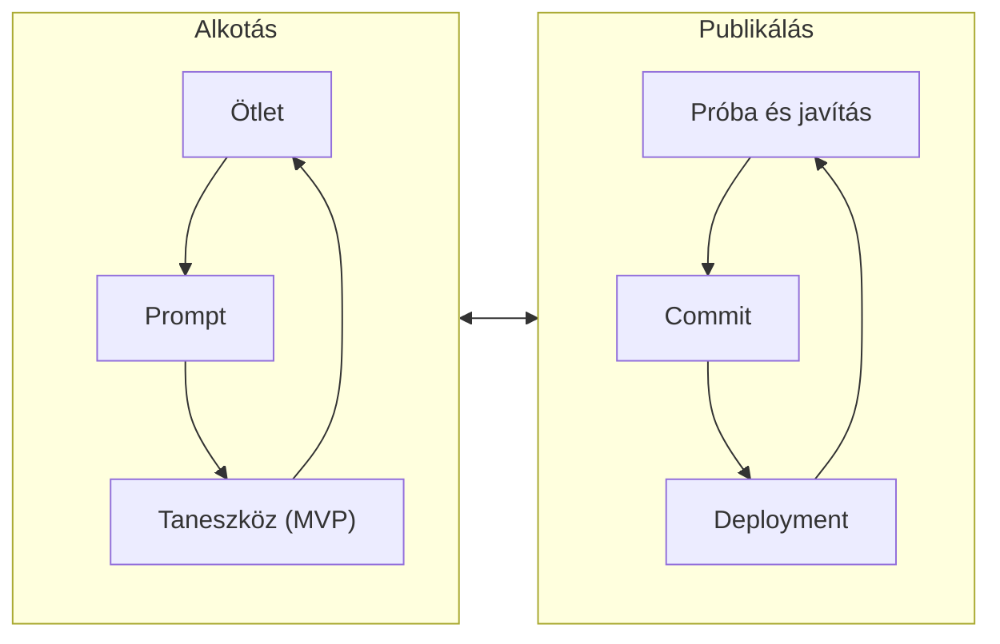

# Ötletből kattintható taneszköz
Mesterséges intelligenciával.

**A pedagógiai célt és az ötleteket te hozod; az AI a megvalósításban segít.**

Programozói előismeret nem szükséges. Hozz ötletet és telefont!

🌐 [A workshop oldala](https://ezolmik.github.io/ai-taneszkoz-workshop/)

## A repóban

- 📄 [index.html](index.html) – a workshop főoldala
- 📁 [prezentacio/](prezentacio/) – rövid böngészős prezentáció
- 📁 [peldak/](peldak/) – játékok és a hozzájuk tartozó promptok

## Most te jössz!

1. **Fork:** készíts saját másolatot erről a repóról.
2. **Pages:** publikáld a saját oldaladat GitHub Pages-en.
3. **Alakítsd tovább:** írj át egy szópárt, feliratot vagy emojit.
4. **Commit:** mentsd el, majd nézd meg a publikált változást!

Nagyobb ötleted van? Írd át az egyik példa promptját,
és készíttesd el az új taneszközt az AI-al!