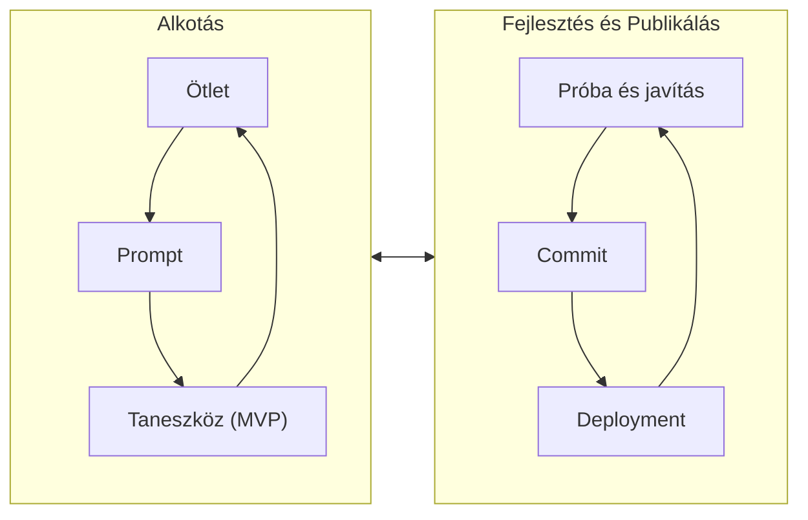

## Ötletből kattintható taneszköz

A pedagógiai célt és az ötleteket Te hozod; az AI a megvalósításban segít.

Programozói előismeret nem szükséges. Hozz ötletet és telefont!

🌐 [A workshop oldala](https://ezolmik.github.io/ai-taneszkoz-workshop/)

### A repóban

- 📄 [index.html](index.html) – a workshop főoldala
- 📁 [prezentacio/](prezentacio/) – rövid böngészős prezentáció
- 📁 [peldak/](peldak/) – játékok és a hozzájuk tartozó promptok
- 📁 [sajat-otletek/](sajat-otletek/) – útmutató a továbblépéshez és [módszertani segédlet](sajat-otletek/README.md)

### Most te jössz!

1. **Fork:** készíts saját másolatot erről a repóról.
2. **Pages:** publikáld a saját oldaladat GitHub Pages-en.
3. **Alakítsd tovább:** írj át egy szópárt, feliratot vagy emojit.
4. **Commit:** mentsd el, majd nézd meg a publikált változást!

Nagyobb ötleted van? Írd át az egyik példa promptját,
és készíttesd el az új taneszközt az AI-al!

---

### 📚 Módszertani háttér

A workshop megközelítése a modern oktatástechnológia és a szoftvertervezés határterületére épít, ahol a pedagógus nem passzív felhasználója, hanem aktív tervezője a digitális tanulási környezetnek:

- **Teachers as Designers (TaD of TEL):** A neveléstudományi irányzat alapvetése, hogy a tanárok a saját tanulócsoportjuk egyedi igényeire szabott digitális eszközöket terveznek *(McKenney & Kali)*.
- **TPACK keretrendszer:** A hatékony taneszköz a szaktárgyi tudás (*Tartalom*), a módszertan (*Pedagógia*) és a digitális keret (*Technológia*) metszetében születik *(Mishra & Koehler)*.
- **Learning Experience Design (LXD):** A hagyományos oktatástervezés *(Instructional Design)* és a felhasználói élmény *(UX)* ötvözése, amely a diákok interakcióira és azonnali visszacsatolására épít.
- **End-User Development & Vibe Coding:** A programozói előképzettség nélküli szoftveralkotás gyakorlata, ahol a tanár természetes nyelven, pedagógiai szándékkal irányítja a kódgenerálást.
